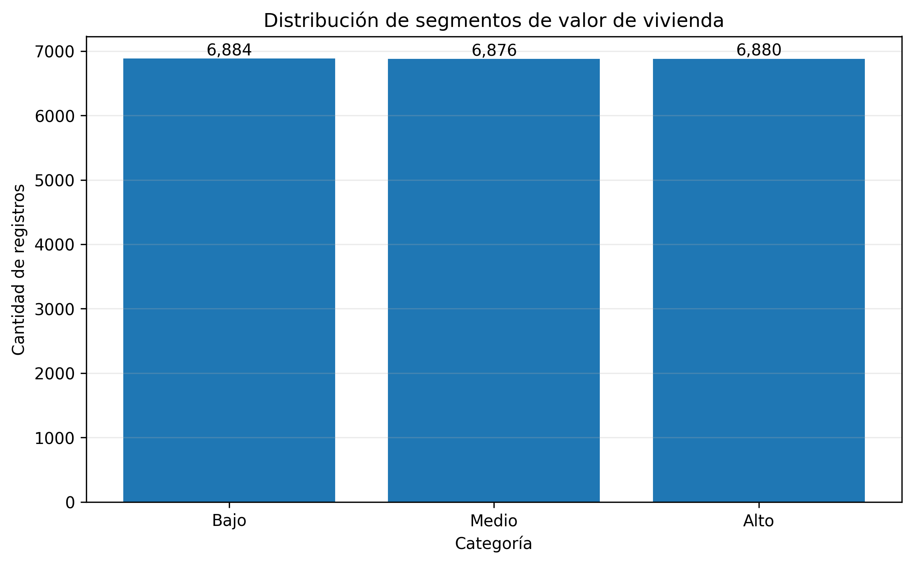
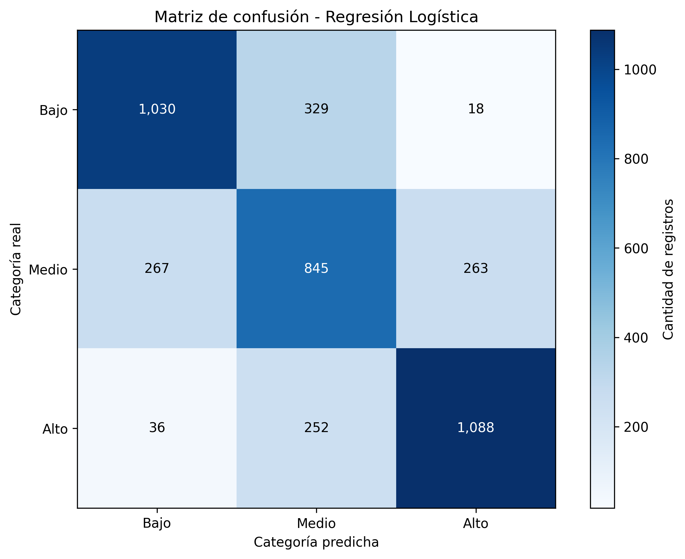
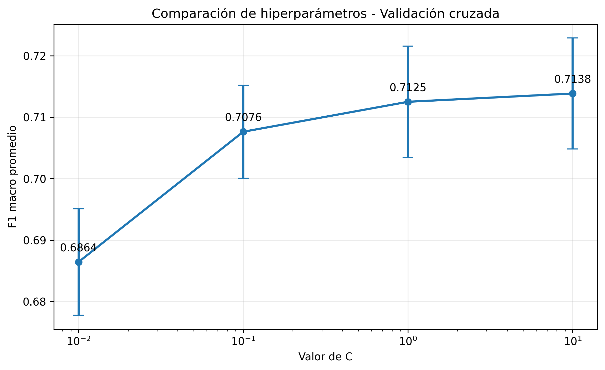

# Machine Learning

Repositorio académico del proyecto de Machine Learning. Contiene tres actividades prácticas orientadas al procesamiento de datos, análisis exploratorio, construcción de modelos de aprendizaje automático, evaluación de resultados y automatización de procesos mediante GitHub Actions.

El proyecto utiliza Python y herramientas del ecosistema de ciencia de datos para construir flujos reproducibles desde la obtención de datos hasta la generación de reportes.

## 👥 Integrantes del grupo

- Katerin Lopez Moros — [@KateLopez05](https://github.com/KateLopez05)
- Bayron Meza Guzman — [@BayronMgDev](https://github.com/BayronMgDev)

## 🛠️ Tecnologías utilizadas

- Python 3.12
- Jupyter Notebook
- Pandas
- NumPy
- Matplotlib
- Scikit-learn
- Hugging Face Datasets
- Git y GitHub
- GitHub Actions

Las dependencias están centralizadas en `requirements.txt`, con versiones definidas para facilitar la reproducibilidad del entorno.

---

# 📂 Estructura del repositorio

```text
Machine-Learning/
│
├── .github/
│   └── workflows/
│       ├── ejecutar.yml
│       ├── ejecutar_ea2.yml
│       └── ejecutar_ea3.yml
│
├── src/
│   ├── clases/
│   │   ├── loader_hf.py
│   │   ├── reporte.py
│   │   ├── regresion_lineal.py
│   │   └── clasificador_tabular.py
│   │
│   └── notebook/
│       ├── notebook_1.ipynb
│       ├── notebook_2.ipynb
│       ├── notebook_3.ipynb
│       │
│       ├── data/
│       │
│       ├── modelos/
│       │   ├── entrega_2/
│       │   └── entrega_3/
│       │
│       └── reportes/
│           ├── entrega_1/
│           ├── entrega_2/
│           │   └── resumen_modelos.txt
│           └── entrega_3/
│               ├── resumen_modelo.txt
│               ├── hallazgos_actividad_3.md
│               └── figuras/
│                   ├── 01_distribucion_categorias.png
│                   ├── 02_matriz_confusion.png
│                   └── 03_comparacion_hiperparametros.png
│
├── requirements.txt
└── README.md
```

Los directorios de modelos y datos pueden generarse localmente durante la ejecución. Los archivos de resultados publicados dependen de la configuración de cada workflow.

---

# 🧪 Entrega 1: Carga y transformación de datos

Esta actividad desarrolla un flujo de trabajo para obtener conjuntos de datos desde Hugging Face, convertirlos en DataFrames y aplicar operaciones de transformación utilizando Pandas.

### Proceso desarrollado

1. Carga de datasets mediante la clase `HFDatasetLoader`.
2. Conversión de los datos a un DataFrame.
3. Renombrado de columnas.
4. Filtrado de registros.
5. Selección de variables.
6. Creación de nuevas columnas.
7. Generación de reportes descriptivos mediante la clase `Reportes`.

### Operaciones utilizadas

| Operación | Herramienta |
|---|---|
| Renombrar columnas | `rename()` |
| Filtrar registros | Condiciones booleanas |
| Seleccionar columnas | Indexación de Pandas |
| Crear variables | Operaciones sobre DataFrames |
| Describir los datos | Estadísticas descriptivas |

El reporte permite consultar las dimensiones del DataFrame, tipos de datos, valores nulos, duplicados y estadísticas descriptivas.

**Notebook:** `src/notebook/notebook_1.ipynb`

---

# 📊 Entrega 2: Regresión y clasificación

**Dataset:** [California Housing - Hugging Face](https://huggingface.co/datasets/BrianSuToronto/california_housing)

Esta actividad aborda el procesamiento de datos y la construcción de modelos de aprendizaje automático para resolver problemas de regresión y clasificación.

### Proceso desarrollado

1. Obtención automática del dataset.
2. Construcción del DataFrame.
3. Exploración y análisis de los datos.
4. Preprocesamiento de variables.
5. División de datos en entrenamiento y prueba.
6. Entrenamiento de modelos.
7. Evaluación mediante métricas.
8. Generación de un resumen de resultados.

### Clases reutilizables

- `HFDatasetLoader`: carga datasets desde Hugging Face.
- `Reportes`: genera reportes descriptivos.
- `RegresionLineal`: organiza el entrenamiento y evaluación de modelos de regresión.
- `ClasificadorTabular`: implementa procesos de clasificación tabular.

### Resultados de referencia

| Modelo | Métrica | Resultado |
|---|---|---:|
| Regresión lineal | MAE | 0.497 |
| Regresión lineal | RMSE | 0.691 |
| Regresión lineal | R² | 0.651 |
| Regresión logística | Accuracy | 0.730 |
| Regresión logística | F1 macro | 0.730 |

El MAE de regresión corresponde aproximadamente a 49.653 USD, teniendo en cuenta que el valor objetivo está expresado en cientos de miles de dólares.

**Notebook:** `src/notebook/notebook_2.ipynb`

**Reporte:** `src/notebook/reportes/entrega_2/resumen_modelos.txt`

---

# 🤖 Entrega 3: Clasificación supervisada del valor de viviendas

## 1. Pregunta de negocio

**¿Qué características socioeconómicas y geográficas permiten identificar si una zona residencial de California pertenece a un segmento de valor de vivienda bajo, medio o alto?**

### ¿Quién necesita esta información?

La información está dirigida a analistas inmobiliarios, investigadores y personas encargadas de estudiar el comportamiento del mercado de vivienda.

### ¿Qué decisión apoya?

Permite identificar patrones relacionados con el valor de las viviendas y clasificar zonas residenciales en segmentos de valor. Esto puede apoyar análisis comparativos, estudios de mercado y procesos de identificación de zonas con características similares.

El modelo es una herramienta de análisis y clasificación; no sustituye una valoración inmobiliaria profesional.

## 2. Identificación del dataset

**Nombre:** California Housing

**Identificador en Hugging Face:** `BrianSuToronto/california_housing`

**Fuente:** Hugging Face Datasets

**Enlace:** [https://huggingface.co/datasets/BrianSuToronto/california_housing](https://huggingface.co/datasets/BrianSuToronto/california_housing)

**Configuración utilizada:** conjunto `train`.

El dataset se obtiene automáticamente desde Hugging Face mediante la biblioteca `datasets`. No se requiere que cada integrante descargue manualmente un archivo para ejecutar el notebook.

La selección y el uso del dataset deben corresponder a la asignación autorizada para el grupo. Su exclusividad debe verificarse frente a las instrucciones del docente.

## 3. Construcción automática del DataFrame

La carga se realiza utilizando la clase `HFDatasetLoader`, que permite obtener el dataset y convertirlo en un DataFrame de Pandas.

El conjunto utilizado contiene:

- 20.640 registros.
- 9 columnas originales.
- Una variable objetivo creada durante el procesamiento.
- 8 variables predictoras utilizadas por el modelo.

Este procedimiento permite reproducir la obtención de los datos desde la fuente original.

## 4. Preprocesamiento y transformación de datos

El preprocesamiento prepara los datos para el entrenamiento y evita que problemas de calidad afecten los resultados.

### Validación inicial

Se realizaron las siguientes comprobaciones:

| Validación | Resultado |
|---|---:|
| Registros originales | 20.640 |
| Valores nulos | 0 |
| Registros duplicados | 0 |
| Columnas originales | 9 |

### Construcción de la variable objetivo

Se creó la variable `Categoria_valor` utilizando los terciles de `Valor_mediano_vivienda`.

Las observaciones se clasificaron en tres segmentos:

- Bajo.
- Medio.
- Alto.

### Distribución de categorías

| Categoría | Registros |
|---|---:|
| Bajo | 6.884 |
| Medio | 6.876 |
| Alto | 6.880 |
| **Total** | **20.640** |

La distribución es aproximadamente equilibrada, lo que facilita la evaluación de un clasificador multiclase.

### Variables predictoras

Se seleccionaron ocho variables:

| Variable | Descripción |
|---|---|
| `Ingreso_mediano` | Ingreso mediano de los hogares. |
| `Edad_vivienda` | Antigüedad de las viviendas. |
| `Promedio_habitaciones` | Promedio de habitaciones. |
| `Promedio_dormitorio_hogar` | Relación promedio de dormitorios por hogar. |
| `Poblacion` | Población de la zona. |
| `Promedio_ocupacion` | Ocupación promedio de las viviendas. |
| `Latitud` | Ubicación geográfica. |
| `Longitud` | Ubicación geográfica. |

La variable original `Valor_mediano_vivienda` se excluye de las variables predictoras porque se utiliza para construir la categoría que el modelo debe aprender a identificar.

### Transformaciones aplicadas

1. Validación de valores nulos y duplicados.
2. Revisión de tipos de datos.
3. Análisis de valores extremos mediante el rango intercuartílico (IQR).
4. Construcción de la variable objetivo.
5. División estratificada de los datos.
6. Estandarización de las variables numéricas mediante `StandardScaler`.

### División de los datos

Se utilizó una división estratificada del 80 % para entrenamiento y 20 % para prueba, con `random_state=42`.

| Conjunto | Registros |
|---|---:|
| Entrenamiento | 16.512 |
| Prueba | 4.128 |
| **Total** | **20.640** |

La estratificación conserva aproximadamente la proporción de las tres categorías en ambos conjuntos.

## 5. Modelo de aprendizaje automático

### Regresión Logística

Se seleccionó un modelo de **Regresión Logística multiclase**, perteneciente al aprendizaje supervisado.

Aunque su nombre contiene la palabra regresión, este algoritmo se utiliza para resolver problemas de clasificación.

### ¿Cómo funciona?

El modelo aprende la relación entre las variables predictoras y las categorías objetivo a partir de los datos de entrenamiento.

Su funcionamiento general es:

1. Recibe las ocho variables predictoras de cada zona residencial.
2. Estandariza las variables mediante `StandardScaler`.
3. Aprende coeficientes asociados a las características de los datos.
4. Calcula probabilidades de pertenencia a las categorías Bajo, Medio y Alto.
5. Selecciona la categoría con mayor probabilidad como predicción.

Para la clasificación multiclase se utiliza la función softmax, que permite obtener probabilidades para cada categoría.

### ¿Por qué se seleccionó?

La Regresión Logística se eligió porque:

- Permite resolver problemas de clasificación multiclase.
- Es adecuada para trabajar con variables numéricas estandarizadas.
- Permite analizar la relación entre las variables predictoras y las categorías.
- Ofrece un modelo interpretable y una base de comparación para otros algoritmos.
- Permite evaluar el desempeño mediante métricas de clasificación.

### Pipeline

El modelo se implementó mediante un pipeline de Scikit-learn:

```python
Pipeline([
    ("escalador", StandardScaler()),
    ("modelo", LogisticRegression())
])
```

El escalador y el clasificador se integran en un mismo flujo para garantizar que el preprocesamiento se aplique consistentemente durante el entrenamiento y la evaluación.

## 6. Optimización de hiperparámetros

Se utilizó `GridSearchCV` para buscar la mejor configuración del modelo.

La validación se realizó mediante `StratifiedKFold` con cinco particiones.

### Parámetros principales

| Parámetro | Configuración |
|---|---|
| Modelo | LogisticRegression |
| Hiperparámetro evaluado | `C` |
| Estrategia de búsqueda | GridSearchCV |
| Validación cruzada | StratifiedKFold |
| Número de particiones | 5 |
| Métrica de selección | F1 macro |
| Semilla de aleatoriedad | 42 |

La mejor configuración encontrada fue:

```python
{
    "modelo__C": 10.0
}
```

El valor de `C` controla la regularización del modelo. En términos generales, valores mayores reducen la intensidad de la regularización.

El mejor F1 macro promedio obtenido durante la validación cruzada fue aproximadamente `0.713849`.

## 7. Métricas y evaluación

El modelo se evaluó utilizando el conjunto de prueba, que contiene 4.128 registros.

### Resultados generales

| Métrica | Resultado |
|---|---:|
| Accuracy | 0.7178 |
| F1 macro | 0.7187 |
| F1 ponderado | 0.7188 |

### Resultados por categoría

| Categoría | Precision | Recall | F1-score |
|---|---:|---:|---:|
| Bajo | 0.7727 | 0.7480 | 0.7601 |
| Medio | 0.5926 | 0.6145 | 0.6034 |
| Alto | 0.7947 | 0.7907 | 0.7927 |

### Interpretación de las métricas

- **Accuracy:** representa la proporción de predicciones correctas sobre el total de observaciones.
- **Precision:** mide qué proporción de las predicciones de una categoría fue correcta.
- **Recall:** mide qué proporción de los registros reales de una categoría fue identificada correctamente.
- **F1-score:** combina precision y recall mediante su media armónica.
- **F1 macro:** calcula el promedio del F1-score de las categorías, dando el mismo peso a cada una.
- **F1 ponderado:** calcula el promedio considerando la cantidad de registros de cada categoría.

Se utiliza F1 macro como métrica de optimización porque permite evaluar las tres categorías sin dar mayor peso a una por su cantidad de observaciones.

### Matriz de confusión

| Categoría real | Predicho Bajo | Predicho Medio | Predicho Alto |
|---|---:|---:|---:|
| Bajo | 1.030 | 329 | 18 |
| Medio | 267 | 845 | 263 |
| Alto | 36 | 252 | 1.088 |

El modelo obtuvo 2.963 predicciones correctas y 1.165 errores.

La mayor dificultad se presenta en la categoría Medio. La mayoría de los errores ocurre entre categorías vecinas, lo que indica que el modelo tiene dificultades para distinguir algunas zonas cuyos valores se encuentran cerca de los límites de los terciles.

## 8. Visualizaciones

Las visualizaciones permiten analizar la distribución de las categorías, el comportamiento del modelo y la optimización de sus parámetros.

### Distribución de categorías



### Matriz de confusión



### Comparación de hiperparámetros



## 9. Hallazgos y recomendaciones

Los resultados permiten identificar los siguientes hallazgos:

1. Las características económicas y habitacionales permiten clasificar las zonas residenciales en segmentos de valor.
2. El modelo presenta un desempeño general de aproximadamente 71,78 % de exactitud.
3. Las categorías Bajo y Alto presentan mejores resultados de clasificación que la categoría Medio.
4. Los errores se concentran principalmente entre categorías vecinas.
5. La categoría Medio requiere mayor atención porque presenta el F1-score más bajo.

### Recomendaciones

- Incorporar nuevas variables socioeconómicas y geográficas que permitan mejorar la separación entre categorías.
- Evaluar otros algoritmos de clasificación para comparar su desempeño.
- Analizar con mayor detalle las observaciones clasificadas incorrectamente.
- Revisar la definición de los límites de las categorías para comprender las dificultades de clasificación.
- Realizar nuevas pruebas con diferentes configuraciones de hiperparámetros.

### Limitación metodológica

En esta implementación, los terciles utilizados para construir la variable objetivo se calcularon sobre el conjunto completo antes de realizar la división entre entrenamiento y prueba.

Aunque la variable original de valor se excluyó de las predictoras, este procedimiento utiliza información de la distribución del conjunto de prueba para definir los límites de las categorías.

Para una evaluación metodológicamente más rigurosa, se recomienda calcular los límites de los terciles exclusivamente con los datos de entrenamiento y aplicar esos mismos límites al conjunto de prueba.

Esta mejora permitiría reducir el riesgo de fuga de información durante la construcción de la variable objetivo.

**Documento completo de hallazgos:**

`src/notebook/reportes/entrega_3/hallazgos_actividad_3.md`

## 10. Generación automática del resumen

Durante la ejecución del notebook se genera automáticamente el archivo:

```text
src/notebook/reportes/entrega_3/resumen_modelo.txt
```

Este archivo contiene información relevante del proceso, incluyendo:

- Identificación del dataset.
- Características generales de los datos.
- Distribución de las categorías.
- Configuración del modelo.
- Hiperparámetros seleccionados.
- Métricas de evaluación.
- Resultados de la clasificación.

La fecha de ejecución se registra utilizando la zona horaria `America/Bogota`.

El modelo entrenado se almacena localmente en:

```text
src/notebook/modelos/entrega_3/
```

---

# ⚙️ Instalación y configuración

## Requisitos previos

- Python 3.12.
- Git.
- Acceso a internet para obtener los datasets desde Hugging Face.

## 1. Clonar el repositorio

```bash
git clone https://github.com/KateLopez05/Machine-Learning.git

cd Machine-Learning
```

## 2. Crear un entorno virtual

```bash
python -m venv .venv
```

### Activar el entorno

**Windows PowerShell:**

```powershell
.venv\Scripts\Activate.ps1
```

**Linux, macOS y GitHub Codespaces:**

```bash
source .venv/bin/activate
```

## 3. Instalar las dependencias

```bash
python -m pip install --upgrade pip

python -m pip install -r requirements.txt
```

## 4. Verificar las dependencias

```bash
python -m pip check
```

---

# ▶️ Ejecución de los notebooks

Los notebooks pueden ejecutarse desde Jupyter Notebook o Visual Studio Code, seleccionando el kernel correspondiente al entorno virtual `.venv`.

Para iniciar Jupyter:

```bash
jupyter notebook
```

### Ejecución desde terminal

**Entrega 1**

```bash
jupyter nbconvert --to notebook --execute src/notebook/notebook_1.ipynb
```

**Entrega 2**

```bash
jupyter nbconvert --to notebook --execute src/notebook/notebook_2.ipynb
```

**Entrega 3**

```bash
jupyter nbconvert --to notebook --execute src/notebook/notebook_3.ipynb
```

Los notebooks requieren conexión a internet para descargar los conjuntos de datos cuando no se encuentran disponibles en caché.

---

# 🔄 Automatización con GitHub Actions

El proyecto cuenta con tres workflows independientes para ejecutar automáticamente las actividades.

| Workflow | Actividad | Archivo |
|---|---|---|
| Ejecutar EA1 | Entrega 1 | `ejecutar.yml` |
| Ejecutar EA2 | Entrega 2 | `ejecutar_ea2.yml` |
| Ejecutar EA3 | Entrega 3 | `ejecutar_ea3.yml` |

### Funcionamiento

Los workflows automatizan las siguientes tareas:

1. Descargar el código del repositorio.
2. Configurar Python 3.12.
3. Instalar las dependencias desde `requirements.txt`.
4. Preparar los directorios de resultados.
5. Ejecutar el notebook correspondiente.
6. Verificar que los resultados se hayan generado.
7. Publicar los resultados como artefactos descargables.
8. Guardar los archivos de resultados en GitHub cuando el workflow lo tiene configurado.

### Consultar las ejecuciones

1. Ingresar al repositorio en GitHub.
2. Abrir la pestaña **Actions**.
3. Seleccionar el workflow de la actividad.
4. Consultar el resultado de la ejecución.
5. Revisar los registros de cada paso.
6. Descargar los artefactos disponibles en la sección **Artifacts**.

### Evidencias de ejecución

Las ejecuciones exitosas de las tres actividades pueden consultarse aquí:

- [Ejecución EA1](https://github.com/KateLopez05/Machine-Learning/actions/runs/42500182591)
- [Ejecución EA2](https://github.com/KateLopez05/Machine-Learning/actions/runs/42501314474)
- [Ejecución EA3](https://github.com/KateLopez05/Machine-Learning/actions/runs/42501314412)

El artefacto de la Entrega 3 se publica con el nombre:

```text
entrega-3-resultados
```

Los artefactos tienen un periodo de disponibilidad limitado, según la configuración de retención del workflow.

---

# 🧾 Control de versiones

Para actualizar el repositorio local:

```bash
git pull --rebase origin main
```

Después de realizar modificaciones:

```bash
git add .

git commit -m "docs: actualizar documentación del proyecto"

git push origin main
```

Si existen cambios divergentes entre la rama local y la remota, se recomienda revisar primero el estado del repositorio y sincronizar los cambios antes de realizar nuevos commits.

No se deben subir credenciales, tokens ni información sensible.

---

# 📋 Checklist de entrega

| Requisito | Evidencia |
|---|---|
| Pregunta de negocio | Definida en la Entrega 3. |
| Dataset e identificador | Fuente e identificador de Hugging Face documentados. |
| DataFrame automático | Clase `HFDatasetLoader`. |
| Preprocesamiento | Validaciones y transformaciones en el notebook. |
| Modelo de aprendizaje automático | Regresión Logística multiclase. |
| Métricas y evaluación | Accuracy, Precision, Recall, F1 y matriz de confusión. |
| Resumen automático | `resumen_modelo.txt`. |
| Documento de hallazgos | `hallazgos_actividad_3.md`. |
| Automatización | GitHub Actions y artefactos. |
| Control de versiones | Git, GitHub e instrucciones de ejecución. |

---

# 📌 Estado del proyecto

Las tres actividades cuentan con notebooks desarrollados y ejecuciones exitosas verificadas mediante GitHub Actions.

El repositorio reúne:

- Código reutilizable para carga y procesamiento de datos.
- Notebooks de las tres actividades.
- Modelos de aprendizaje automático.
- Reportes y visualizaciones.
- Documentación metodológica.
- Automatización de ejecución y publicación de resultados.

**Repositorio oficial:**

[https://github.com/KateLopez05/Machine-Learning](https://github.com/KateLopez05/Machine-Learning)

**Objetivo:** desarrollar procesos de análisis de datos y aprendizaje automático reproducibles, documentados y verificables.