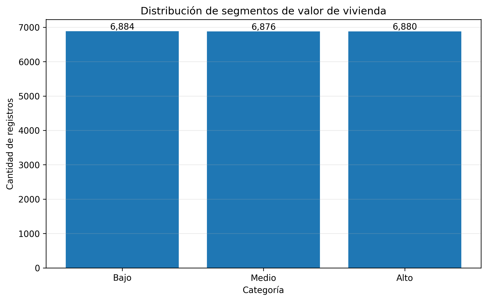
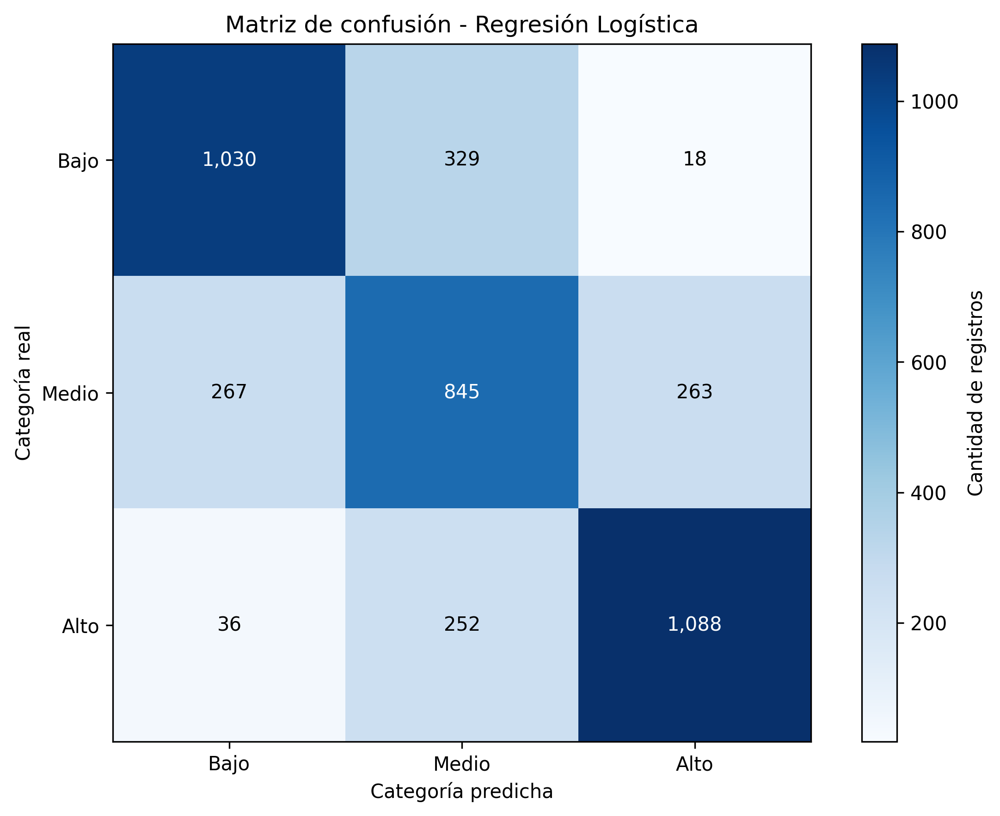
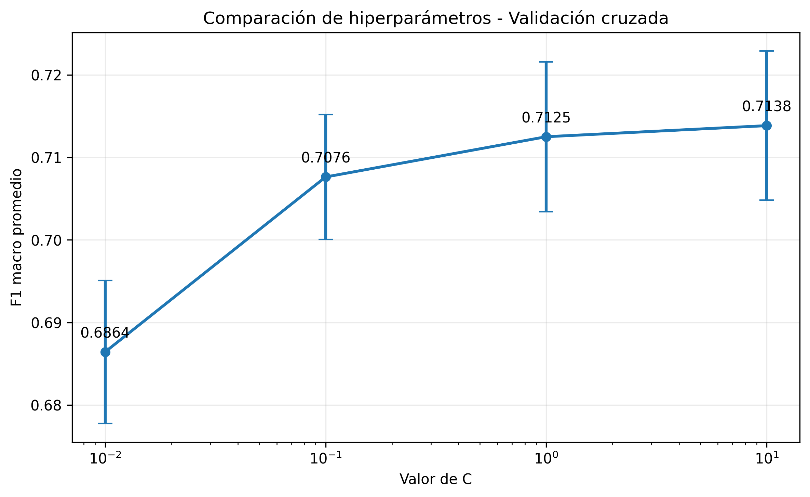

# Documento de hallazgos – Actividad 3

## Clasificación de segmentos de valor de vivienda en California

### 1. Objetivo del análisis

El propósito de este análisis es identificar qué características socioeconómicas, habitacionales y geográficas permiten clasificar las zonas residenciales de California en tres segmentos de valor de vivienda: Bajo, Medio y Alto.

La pregunta de negocio planteada fue:

**¿Qué características socioeconómicas y geográficas permiten identificar si una zona residencial de California pertenece a un segmento de valor de vivienda bajo, medio o alto?**

Para responder esta pregunta se desarrolló un modelo de aprendizaje supervisado que identifica patrones en los datos y utiliza la información aprendida para clasificar nuevas observaciones.

### 2. Datos utilizados y metodología

Se utilizó el conjunto de datos `BrianSuToronto/california_housing`, correspondiente a información de viviendas de California.

El conjunto contiene 20.640 registros y 9 columnas originales. Durante el preprocesamiento se renombraron las variables al español y se construyó una nueva variable denominada `Categoria_valor`, mediante la división del valor mediano de vivienda en tres terciles:

- **Bajo:** tercio inferior de los valores.
- **Medio:** tercio intermedio.
- **Alto:** tercio superior.

La distribución obtenida fue:

| Categoría | Registros |
|---|---:|
| Bajo | 6.884 |
| Medio | 6.876 |
| Alto | 6.880 |
| **Total** | **20.640** |

Se seleccionaron ocho variables predictoras:

1. Ingreso mediano.
2. Edad de la vivienda.
3. Promedio de habitaciones.
4. Promedio de dormitorios por hogar.
5. Población.
6. Promedio de ocupación.
7. Latitud.
8. Longitud.

Se excluyó el valor mediano de vivienda de las variables predictoras porque fue utilizado para construir la categoría objetivo.

Los datos se dividieron en un 80 % para entrenamiento y un 20 % para prueba, utilizando una división estratificada y `random_state=42`.

La división produjo los siguientes conjuntos:

- Entrenamiento: 16.512 registros.
- Prueba: 4.128 registros.

El escalado se realizó mediante `StandardScaler` dentro de un pipeline, de manera que los parámetros de transformación se ajustaran utilizando los datos de entrenamiento.

### 3. Modelo desarrollado y optimización

Se utilizó aprendizaje supervisado mediante un problema de clasificación multiclase, implementado con el algoritmo de Regresión Logística (`LogisticRegression`).

Posteriormente, se realizó una optimización de hiperparámetros utilizando `GridSearchCV`, con validación cruzada estratificada de cinco particiones (`StratifiedKFold`) y la métrica F1 macro como criterio de selección.

Se evaluaron cuatro valores del hiperparámetro `C`:

| C | F1 macro promedio | Desviación estándar |
|---:|---:|---:|
| 0.01 | 0.6864 | 0.0087 |
| 0.10 | 0.7076 | 0.0076 |
| 1.00 | 0.7125 | 0.0091 |
| 10.00 | **0.7138** | 0.0090 |

La mejor configuración encontrada fue:

**C = 10.0**

Este valor obtuvo un F1 macro promedio de 0.7138 durante la validación cruzada.

Aunque `C=10.0` presentó el mayor resultado promedio, la diferencia frente a `C=1.0` fue de apenas 0.0013. Por tanto, no debe interpretarse como una mejora estadísticamente significativa, ya que no se realizó una prueba de significancia.

La configuración final utilizó:

- Algoritmo: Regresión Logística.
- Hiperparámetro `C`: 10.0.
- `max_iter`: 1000.
- `random_state`: 42.
- Escalado: `StandardScaler`.
- Validación cruzada: 5 particiones estratificadas.
- Métrica de selección: F1 macro.

### 4. Resultados y hallazgos principales

El modelo optimizado fue evaluado con 4.128 registros que no participaron en su entrenamiento.

Los resultados generales fueron:

| Métrica | Resultado |
|---|---:|
| Exactitud (Accuracy) | 0.7178 |
| F1 macro | 0.7187 |
| F1 ponderado | 0.7188 |

La exactitud indica que el modelo clasificó correctamente aproximadamente el 71,78 % de las observaciones del conjunto de prueba.

El F1 macro permite evaluar el equilibrio del desempeño entre las tres categorías, mientras que el F1 ponderado considera también la cantidad de registros de cada categoría.

#### 4.1. Distribución de las categorías

La gráfica presenta la cantidad de observaciones pertenecientes a cada segmento de valor de vivienda.

Se observa una distribución equilibrada entre las tres categorías:

- Bajo: 6.884 registros.
- Medio: 6.876 registros.
- Alto: 6.880 registros.

Esta distribución permite trabajar con categorías de tamaños similares y evita que una clase tenga una representación considerablemente superior a las demás.

Es importante aclarar que esta distribución corresponde al conjunto de datos completo y no exclusivamente al conjunto de prueba.

#### 4.2. Desempeño por categoría

Los resultados individuales del modelo optimizado fueron:

| Categoría | Precisión | Recall | F1-score |
|---|---:|---:|---:|
| Bajo | 0.7727 | 0.7480 | 0.7601 |
| Medio | 0.5926 | 0.6145 | 0.6034 |
| Alto | 0.7947 | 0.7907 | 0.7927 |

Los resultados muestran diferencias importantes entre las categorías:

- **Alto:** fue la categoría mejor reconocida, con un F1-score de 0.7927.
- **Bajo:** obtuvo un F1-score de 0.7601, mostrando un desempeño relativamente favorable.
- **Medio:** presentó el menor resultado, con un F1-score de 0.6034. Esto evidencia que sus características se confunden con mayor frecuencia con las de los segmentos Bajo y Alto.

El principal hallazgo es que el modelo diferencia mejor los segmentos extremos que el segmento intermedio.

#### 4.3. Matriz de confusión

La matriz de confusión permite comparar las categorías reales con las categorías predichas por el modelo.

Los valores obtenidos fueron:

| Categoría real | Predicho Bajo | Predicho Medio | Predicho Alto |
|---|---:|---:|---:|
| Bajo | 1.030 | 329 | 18 |
| Medio | 267 | 845 | 263 |
| Alto | 36 | 252 | 1.088 |

De las 4.128 observaciones evaluadas:

- 2.963 fueron clasificadas correctamente.
- 1.165 presentaron una clasificación incorrecta.

Los principales errores fueron:

- 329 registros de categoría Bajo fueron clasificados como Medio.
- 267 registros de categoría Medio fueron clasificados como Bajo.
- 263 registros de categoría Medio fueron clasificados como Alto.
- 252 registros de categoría Alto fueron clasificados como Medio.
- 18 registros de categoría Bajo fueron clasificados como Alto.
- 36 registros de categoría Alto fueron clasificados como Bajo.

Se observa que 1.111 de los 1.165 errores ocurrieron entre categorías vecinas (Bajo-Medio o Medio-Alto). Esto representa aproximadamente el 95,4 % de los errores.

En cambio, los errores directos entre las categorías extremas fueron considerablemente menores, con 54 casos.

Este comportamiento sugiere que las zonas con valores intermedios presentan características que pueden coincidir con las de los segmentos inferior y superior, lo que dificulta su identificación.

#### 4.4. Comparación de hiperparámetros

La gráfica presenta el F1 macro promedio obtenido para cada valor de `C` durante la validación cruzada estratificada de cinco particiones.

Se observa que el rendimiento aumentó progresivamente al incrementar el valor de `C` dentro de las configuraciones evaluadas.

La configuración `C=10.0` obtuvo el mayor F1 macro promedio, con 0.7138, seguida de `C=1.0`, con 0.7125.

La diferencia entre ambas configuraciones es pequeña. Por ello, la selección de `C=10.0` responde a que obtuvo el mayor promedio en la búsqueda realizada, pero no demuestra por sí sola una mejora estadísticamente significativa.

### 5. Respuesta a la pregunta de negocio

Los resultados permiten concluir que las características socioeconómicas, habitacionales y geográficas utilizadas contienen información útil para identificar el segmento relativo de valor de una zona residencial de California.

El modelo logró una exactitud del 71,78 % y un F1 macro de 0.7187 en el conjunto de prueba. Por lo tanto, ofrece una capacidad de clasificación útil como herramienta de análisis inicial.

Las variables seleccionadas permiten distinguir con mayor facilidad las zonas de valor bajo y alto, mientras que la clasificación de las zonas intermedias presenta mayores dificultades.

En consecuencia, el modelo puede apoyar procesos de segmentación y exploración del mercado inmobiliario. Sin embargo, sus predicciones deben interpretarse como una clasificación orientativa y no como una valoración definitiva de una vivienda.

### 6. Confiabilidad y limitaciones

Los resultados presentan elementos favorables:

- Se utilizó un conjunto de prueba independiente del entrenamiento.
- La división de los datos fue estratificada, conservando la distribución de las categorías.
- Se utilizó un pipeline con `StandardScaler`, evitando ajustar el escalador con los datos de prueba.
- Se realizó validación cruzada estratificada de cinco particiones para seleccionar el hiperparámetro.
- La desviación estándar del F1 macro en la configuración seleccionada fue de 0.0090, lo que muestra una variabilidad relativamente reducida entre las particiones de validación.

Sin embargo, deben considerarse las siguientes limitaciones:

1. **Categorías relativas:** los segmentos Bajo, Medio y Alto se construyeron mediante terciles de este conjunto de datos. No representan rangos universales de precios inmobiliarios.

2. **Dificultad de la categoría intermedia:** el F1-score de 0.6034 evidencia que el modelo tiene menor capacidad para reconocer este segmento.

3. **Modelo lineal:** la Regresión Logística puede no representar completamente relaciones complejas o no lineales entre las variables geográficas, económicas y el valor de las viviendas.

4. **Representatividad geográfica y temporal:** los resultados corresponden al conjunto de datos utilizado y no garantizan el mismo desempeño en otras regiones o periodos.

5. **Construcción de las categorías:** los terciles se calcularon sobre el conjunto completo antes de realizar la división entre entrenamiento y prueba. Esto debe tenerse en cuenta al interpretar la evaluación, ya que la definición de los límites de las categorías utilizó información de todo el conjunto.

6. **Validación limitada:** aunque se utilizó validación cruzada para seleccionar el hiperparámetro, la evaluación final se realizó sobre una única partición de prueba. Sería conveniente realizar evaluaciones adicionales con otras particiones o datos externos.

Por estas razones, los resultados son útiles para explorar patrones y orientar análisis, pero no deben considerarse una garantía de clasificación correcta en todos los casos.

### 7. Recomendaciones y acciones derivadas

A partir de los hallazgos se proponen las siguientes acciones:

**1. Utilizar el modelo como herramienta de segmentación inicial.**

Puede emplearse para organizar zonas residenciales en segmentos de valor relativo y facilitar análisis exploratorios del mercado.

**2. Revisar con mayor detalle las zonas clasificadas como categoría Medio.**

Esta categoría presenta el menor F1-score y concentra buena parte de las confusiones. Se recomienda revisar sus características y estudiar si existen patrones adicionales que permitan mejorar su identificación.

**3. Complementar la clasificación con información geográfica.**

La ubicación puede representar relaciones complejas que un modelo lineal no captura completamente. Se recomienda evaluar modelos capaces de identificar patrones no lineales.

**4. Validar el modelo con nuevos datos.**

Antes de utilizarlo en decisiones comerciales o de inversión, conviene evaluar su comportamiento con información inmobiliaria más reciente y de otras zonas geográficas.

**5. Mantener seguimiento de las métricas.**

Se recomienda monitorear la exactitud y el F1-score general, pero también las métricas individuales de Bajo, Medio y Alto. Una mejora global no necesariamente implica una mejora en todas las categorías.

**6. Revisar la construcción de las categorías en futuras versiones.**

Se recomienda calcular los límites de los terciles utilizando exclusivamente los datos de entrenamiento y aplicar esos mismos límites al conjunto de prueba, para fortalecer la separación entre entrenamiento y evaluación.

### 8. Conclusión general

La actividad permitió desarrollar y optimizar un modelo de clasificación supervisada capaz de identificar segmentos relativos de valor de vivienda en California a partir de características socioeconómicas, habitacionales y geográficas.

El modelo optimizado obtuvo una exactitud de 71,78 % y un F1 macro de 0.7187 en el conjunto de prueba.

Su mejor desempeño se presentó en la categoría Alto, seguida de Bajo, mientras que Medio fue la categoría con mayor dificultad de clasificación.

La matriz de confusión permitió identificar que aproximadamente el 95,4 % de los errores se produjeron entre categorías vecinas, lo que evidencia que la principal dificultad del modelo está en distinguir los segmentos intermedios de los extremos.

En términos de negocio, los resultados demuestran que las variables disponibles aportan información relevante para segmentar zonas residenciales. No obstante, el modelo debe utilizarse como apoyo para el análisis y no como sustituto de una valoración inmobiliaria profesional.

La principal oportunidad de mejora consiste en fortalecer la clasificación de la categoría intermedia, evaluar modelos con relaciones no lineales y validar los resultados con datos externos.

---

**Fuente:** ejecución del notebook `notebook_3.ipynb`, Actividad 3.

**Fecha de ejecución de los resultados:** 8 de noviembre de 2026.

**Dataset:** `BrianSuToronto/california_housing`.

**Modelo seleccionado:** Regresión Logística con `C=10.0`.